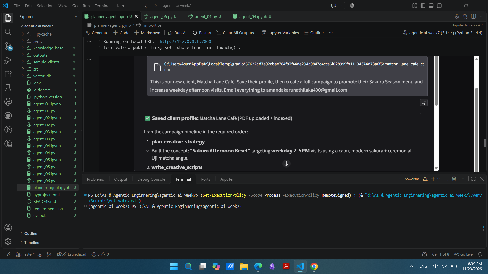
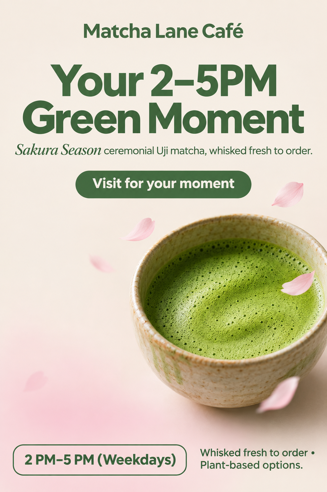

# 🎨 Creative Agency Agents
 
**A multi-agent AI creative agency.** Upload a company PDF, ask for a campaign in plain English, and six specialist agents research, write, design, animate and email a complete marketing campaign: a **poster (PNG)**, a **campaign script (PDF)** and a **20-second vertical video ad (MP4)**.
 
> Built as part of the **Certified Agentic AI Engineering** course led by **Noob Dev**.
 
---
 
## ✨ What it does
 
1. You upload a client's company profile (PDF) in a Gradio chat.
2. You ask for a campaign, e.g. *"Promote the Sakura Season menu to bring more customers in on weekday afternoons."*
3. A **Planner agent** decides which specialist to call, in order, and passes each one's result to the next.
4. The client receives an email with the poster, script and video attached.
 
## 🧠 Architecture
 
```
                         ┌──────────────────────┐
   You (Gradio chat) ──► │    Planner Agent     │  tool-calling loop
   PDF + request         │  planner-agent.ipynb │  (while finish_reason == "tool_calls")
                         └──────────┬───────────┘
            ┌──────────┬────────────┼────────────┬─────────────┬──────────────┐
            ▼          ▼            ▼            ▼             ▼              ▼
       RAG Agent   Strategy    Creative      Poster        Animation     Product
       agent_01    Agent       Writer        Create        Agent         Manager
                   agent_02    agent_03      agent_04      agent_06      agent_05
            │          │            │            │             │              │
         Chroma    Web search   JSON + PDF   Image model   MoviePy (local)  SMTP email
       vector DB
```
 
| # | Agent | File | Tool name | What it does |
|---|-------|------|-----------|--------------|
| 1 | **RAG Agent** | `agent_01` | `save_company_pdf`, `ask_company` | PDF → chunks (1000 / 200 overlap) → embeddings → Chroma. Answers questions about one client only, using a metadata filter. |
| 2 | **Strategy Agent** | `agent_02` | `plan_creative_strategy` | Combines brand facts from RAG with a live web search for current trends and recommends one campaign concept. |
| 3 | **Creative Writer Agent** | `agent_03` | `write_creative_scripts` | Writes a structured campaign script (overview, poster copy, colour palette, 5-scene storyboard, brand notes) as strict JSON, and exports a professional PDF. |
| 4 | **Poster Create Agent** | `agent_04` | `create_poster` | Turns the poster script into a 1024 × 1536 PNG. |
| 5 | **Animation Agent** | `agent_06` | `create_campaign_video` | Builds a 20-second 9:16 video: AI scene stills with Ken Burns motion, animated text, brand-coloured accents, crossfades and a pulsing call-to-action end card. Renders locally on CPU. |
| 6 | **Product Manager Agent** | `agent_05` | `send_to_client` | Writes the social media hook, caption and hashtags, then emails the PNG + PDF + MP4. |
 
## 🛠️ Tech stack
 
| Area | Tools |
|------|-------|
| LLM | `gpt-5.4-nano` via the OpenAI API |
| Embeddings | `text-embedding-3-large` |
| Image generation | `gpt-image-2.6-sunburst` |
| Live research | OpenAI Responses API `web_search` tool |
| RAG | LangChain, Chroma, PyPDF |
| Documents | fpdf2 |
| Video | MoviePy 2, Pillow |
| UI | Gradio |
| Email | smtplib (SMTP) |
| Environment | Python, uv, Jupyter |
 
## 🧩 Agentic concepts used
 
- **Tool calling / function calling**: the Planner never runs code itself. It requests a tool, the code runs the agent, and the result is fed back until no more tools are needed.
- **Orchestrator–worker pattern**: one Planner coordinates specialist agents, each with a single job.
- **Retrieval-Augmented Generation (RAG)**: every creative decision is grounded in the client's own documents.
- **Structured outputs**: the writer returns JSON validated against a strict schema, so later agents can rely on every field.
- **Shared state through file paths**: agents exchange paths (`scripts_path`, `poster_path`, `video_path`) instead of long text.
- **Graceful error handling**: tool errors are returned to the Planner as messages, so it can explain the failure instead of crashing.
 
## 📁 Project structure
 
```
creative-agency-agents/
├── docs/                     
├── sample-clients/          
├── src/                      
├── .env                      
├── .env.example              
├── .gitignore                
├── .python-version
├── agent_01 … agent_06 (.ipynb + .py)
├── planner-agent.ipynb
├── pyproject.toml
├── README.md
├── requirements.txt          
├── uv.lock
│
│  ignored (never pushed):
├── .venv/  __pycache__/  knowledge-base/  outputs/  vector_db/
 
# Created at runtime (not committed)
├── knowledge-base/<company>/  # uploaded client PDFs
├── vector_db/                 # Chroma database
└── outputs/                   # posters, scripts, videos
```
 
Each agent is developed and tested in its own notebook, then converted to a `.py` file so the Planner can import it. Test cells are tagged `test` and removed during conversion, so importing an agent never triggers an API call.

## 📸 Demo
 
<!-- Add your own screenshots and demo video link here -->
| Chat | Poster | Video |
|------|--------|-------|
|  |  | [▶ Watch demo](docs/demo.mp4) |
 
## ⚠️ Notes
 
- Built and tested on **Windows**. The PDF and video agents use `C:\Windows\Fonts\arial.ttf`; on macOS/Linux, change `FONT_REGULAR` / `FONT_BOLD` to a local `.ttf` file.
- The OpenAI API is a paid service. Each full campaign makes several text calls, 4 image generations (1 poster + 3 scene stills) and web searches.
- Keep `.env` private. It is excluded by `.gitignore`.
- `samples/` contains only a fictional company for testing.
 
## 🗺️ Roadmap
 
- [ ] **Brand Critic agent**: reviews the work and sends it back for a rewrite if it goes off-brand (reflection loop)
- [ ] **Human-in-the-loop**: approve the poster before anything is emailed
- [ ] **Campaign memory**: per-client history in SQLite
- [ ] **Guardrails**: block invented prices, offers and health claims
- [ ] **Parallel generation**: create the poster and scene stills at the same time
- [ ] **Observability**: log each tool call's time and token cost
- [ ] **MCP server**: expose the agents to other apps
      
## 👩‍💻 Author
 
**Amanda**, Computing undergraduate, Lanka Nippon BizTech Institute (LNBTI), Sri Lanka
